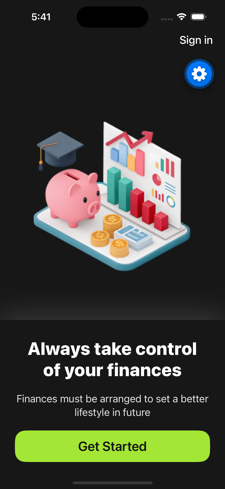
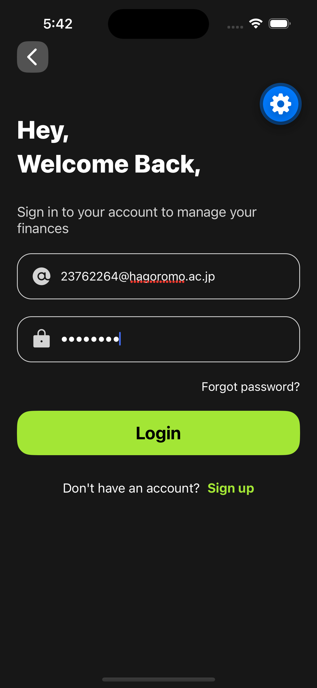
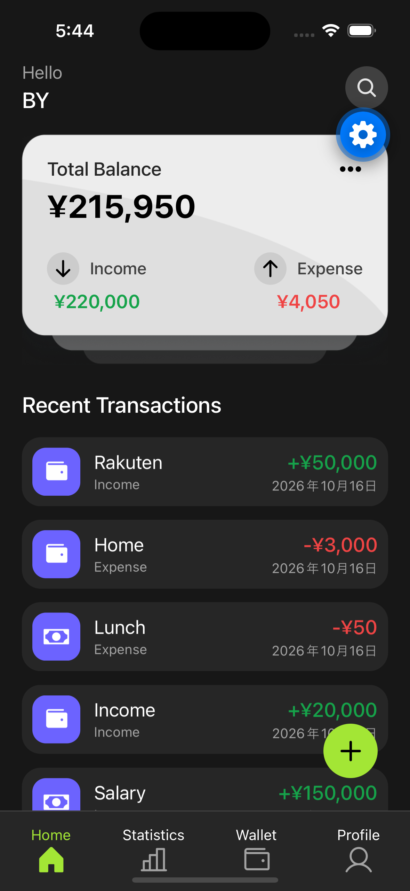
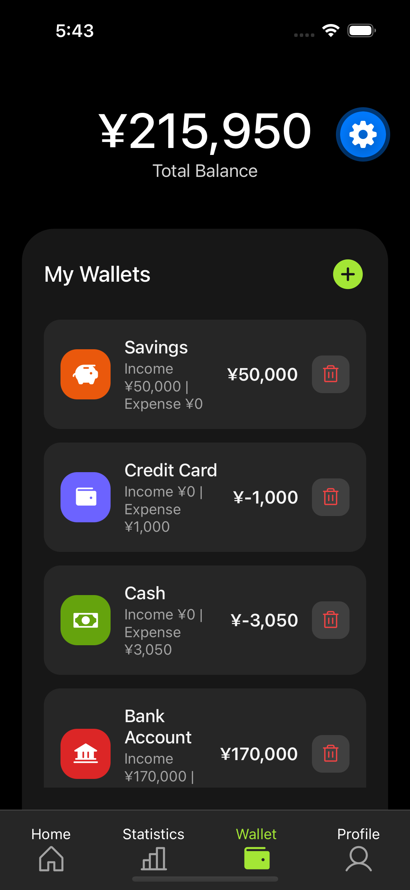
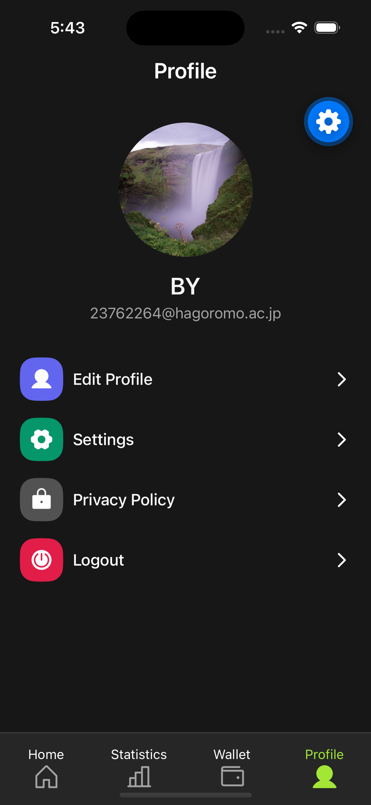
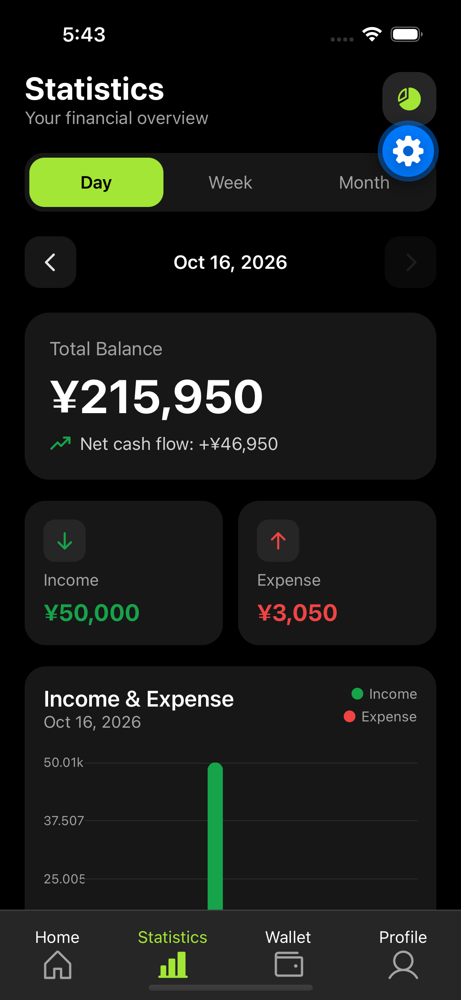
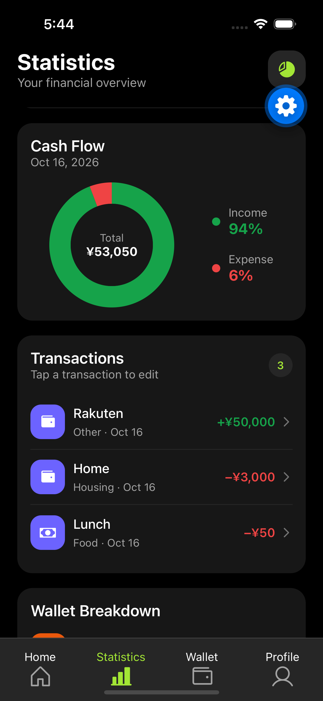

Wallet App

GitHub： https://github.com/110121-RB/wallet-app

1. 概要

Wallet Appは、日々の収入と支出を管理するための家計管理アプリです。

ユーザーが収入・支出を記録し、ウォレットごとの残高や取引履歴を確認できるように開発しました。

2. 主な機能

- ユーザー登録・ログイン
- ウォレットの作成・管理
- 収入・支出の登録・編集・削除
- 取引日を指定した収支の記録
- ウォレットごとの残高管理
- 収入・支出の統計表示
- プロフィール情報の管理

※ 実装済みの機能に合わせて調整してください。

3. 使用技術

- Frontend: React Native, Expo, TypeScript
- Navigation: Expo Router
- Backend / Database: Supabase, PostgreSQL
- Authentication: Supabase Auth
- Deployment: Vercel（Webデモ）

4. デモ

- Demo URL: https://wallet-app-three-chi.vercel.app/

5. 開発目的

React NativeとSupabaseを使用したアプリ開発を通じて、画面設計、データベース設計、認証機能、データの取得・登録・更新・削除について学習することを目的としています。

6. 工夫した点

- ウォレットごとに収入と支出を管理できるように設計しました。
- 取引情報をデータベースと連携し、データを管理できるようにしました。
- ユーザーが使いやすい画面構成を意識して開発しました。

7. 今後の改善点

- UI・UXの改善
- 収支データの分析機能の拡充
- エラー処理と入力チェックの改善

8. 起動方法

必要な環境

- Node.js
- npm

セットアップ

git clone <GitHubリポジトリのURL>
cd wallet-app
npm install
npx expo start

Supabaseの接続設定には、環境変数の設定が必要です。

※ .env などの環境設定ファイルには、認証情報を含めないよう注意してください。

####Screenshots####

Welcom&Login

<p align="center">
   
   
   
</p>

Home & Wallet

<p align="center">
  
  
  
</p>

<p align="center">
  
  
  
</p>

# Welcome to your Expo app 👋

This is an [Expo](https://expo.dev) project created with [`create-expo-app`](https://www.npmjs.com/package/create-expo-app).

## Get started

1. Install dependencies

   ```bash
   npm install
   ```

2. Start the app

   ```bash
   npx expo start
   ```

In the output, you'll find options to open the app in a

- [development build](https://docs.expo.dev/develop/development-builds/introduction/)
- [Android emulator](https://docs.expo.dev/workflow/android-studio-emulator/)
- [iOS simulator](https://docs.expo.dev/workflow/ios-simulator/)
- [Expo Go](https://expo.dev/go), a limited sandbox for trying out app development with Expo

You can start developing by editing the files inside the **app** directory. This project uses [file-based routing](https://docs.expo.dev/router/introduction).

## Get a fresh project

When you're ready, run:

```bash
npm run reset-project
```

<!-- npx expo start --ios -->

This command will move the starter code to the **app-example** directory and create a blank **app** directory where you can start developing.

### Other setup steps

- To set up ESLint for linting, run `npx expo lint`, or follow our guide on ["Using ESLint and Prettier"](https://docs.expo.dev/guides/using-eslint/)
- If you'd like to set up unit testing, follow our guide on ["Unit Testing with Jest"](https://docs.expo.dev/develop/unit-testing/)
- Learn more about the TypeScript setup in this template in our guide on ["Using TypeScript"](https://docs.expo.dev/guides/typescript/)

## Learn more

To learn more about developing your project with Expo, look at the following resources:

- [Expo documentation](https://docs.expo.dev/): Learn fundamentals, or go into advanced topics with our [guides](https://docs.expo.dev/guides).
- [Learn Expo tutorial](https://docs.expo.dev/tutorial/introduction/): Follow a step-by-step tutorial where you'll create a project that runs on Android, iOS, and the web.

## Join the community

Join our community of developers creating universal apps.

- [Expo on GitHub](https://github.com/expo/expo): View our open source platform and contribute.
- [Discord community](https://chat.expo.dev): Chat with Expo users and ask questions.
